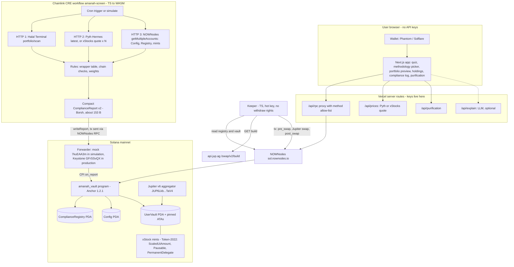

# Amanah

Amanah screens tokenized stocks on three layers (the company, the instrument wrapper, and the token on-chain) and enforces that result inside a Solana vault. A Chainlink CRE workflow writes a compact signed report into an Anchor program. A keeper can buy an xStock only when the output mint is approved under the vault owner's chosen methodology, the route touches only allow-listed programs, and the output clears a fail-closed price floor. STRCx fails the instrument layer, so `MintNotApproved` is a real check. Screening results are not a fatwa, and this project is not Shariah certification.

Built for TOKEN2049 Origins. The program, workflow, keeper, and app in this repository are a buildable skeleton. Product logic is marked with TODO comments and the build-plan task ids (T00–T42).

## Architecture



## Environments

Development stays on LiteSVM and devnet. Mainnet is one deploy, for the demo and the three proof transactions.

| Stage | What runs | Route and prices |
|---|---|---|
| Localnet / LiteSVM | `cargo test` against `programs/amanah-vault` and `programs/mock-route` | Mock route. No Jupiter, no Pyth. |
| Devnet | Program deploy, CRE write, keeper, app. `scripts/devnet-setup.ts` creates test Token-2022 mints (ScaledUiAmount where possible) standing in for AAPLx, NVDAx, MSTRx, and STRCx. | `mock-route` instead of Jupiter. Fixture prices, not Pyth xStock feeds. Public devnet RPC (NOWNodes has no devnet host). |
| Mainnet | Single program deploy, then a human runs the CRE `--broadcast` and the proof swaps. | Real xStock mints, Jupiter `/swap/v2/build`, Pyth xStock prices, NOWNodes `sol.nownodes.io`. |

These only exist on mainnet: a live STRCx rejection against Halal Terminal's real verdict, a Jupiter swap into a real xStock, and the dividend multiplier history used for purification. Devnet stand-ins do not reproduce those.

`Anchor.toml` lists the program id under `[programs.localnet]`, `[programs.devnet]`, and `[programs.mainnet]`. The default provider cluster is devnet. `CLUSTER=devnet` or `CLUSTER=mainnet` selects RPC URLs and mint tables in `packages/common`.

## Repo map

```
Anchor.toml  Cargo.toml  package.json  security.json  README.md  LICENSE
programs/amanah-vault/   state, errors, events, token2022, introspection, instructions
programs/mock-route/     LiteSVM and devnet stand-in for Jupiter
tests/                   LiteSVM suite arrives in T15
cre-workflow/            amanah-screen, devnet and mainnet configs
keeper/src/              plan, build, send, cli
app/                     Next.js App Router and /api routes
packages/common/         constants, portfolio, floor, multiplier, report, idl
scripts/                 check-env, devnet-setup, init-config, set-assets, purification-check, decode-tx
docs/                    design, requirements, build plan
```

## Prerequisites

- Rust 1.89.0 (see `rust-toolchain.toml`)
- Anchor CLI 1.2.1 and Solana CLI 4.1.2 (`avm install 1.2.1 && avm use 1.2.1`; avm resolves the Solana tools)
- Node.js 22 and pnpm 10
- For CRE simulation: CRE CLI 1.36.0 and Bun 1.2.21 or newer

## Quickstart

```bash
pnpm install
cargo check --workspace
pnpm typecheck
pnpm lint
pnpm dev
```

`pnpm dev` starts the Next.js app. `anchor build` and `anchor test` need the Anchor CLI, which this skeleton does not invoke. Copy `.env.example` to `.env` and fill names locally. Do not commit `.env` or keypairs.

Devnet CRE write, once the CLI is installed:

```bash
cre workflow simulate amanah-screen --target devnet
```

Mainnet broadcast is a human step, after the single mainnet deploy. Do not hand the transmitter key to an agent:

```bash
cre workflow simulate amanah-screen --target mainnet --broadcast
```

## Environment variables

Names only. See `.env.example`, `app/.env.example`, `keeper/.env.example`, and `cre-workflow/.env.example`.

| Name | Role |
|---|---|
| `CLUSTER` | `devnet` (default) or `mainnet` |
| `SOLANA_RPC_URL_DEVNET` | Public devnet RPC |
| `SOLANA_RPC_URL_MAINNET` | NOWNodes `https://sol.nownodes.io` |
| `SOLANA_RPC_URL_LOCALNET` | Local validator, if you are not using LiteSVM |
| `NOWNODES_API_KEY` | `api-key` header. Server-side only |
| `JUPITER_API_KEY` | Mainnet keeper `x-api-key` |
| `PYTH_API_KEY` | Mainnet Hermes bearer token |
| `HALAL_TERMINAL_API_KEY` | `X-API-Key` |
| `LLM_API_KEY` | Optional explainer (T41) |
| `PROGRAM_ID`, `KEEPER_KEYPAIR`, `ADMIN_KEYPAIR` | Local paths. Keypairs stay out of git |
| `CRE_ETH_PRIVATE_KEY`, `CRE_SOLANA_PRIVATE_KEY` | CRE CLI. Human-held |
| `CRE_SOLANA_PRIVATE_KEY_TEST` | Throwaway transmitter for the negative test |
| `CHAIN_SELECTOR`, `FORWARDER_PROGRAM`, `FORWARDER_STATE`, `USDC_MINT` | Cluster-specific ids, also in `packages/common` |

Never prefix a key with `NEXT_PUBLIC_`.

## Tracks

1. Chainlink CRE. The registry changes only through `on_report`.
2. Solana. Token-2022, PDA vaults, and the instruction-sysvar guard.
3. NOWNodes. Mainnet reads and the CRE write, when that write goes through NOWNodes. Entering the track is gated on that path (design D3). Devnet does not use NOWNodes.

## Limitations

Screening uses third-party data under a chosen methodology. It is not a fatwa and it is not Shariah certification. Do not describe the result as certified or guaranteed. The code is unaudited hackathon code. The issuer of an xStock can pause the mint and can move tokens with the permanent delegate. Until a DON deploy exists, CRE writes shown here are simulated through Chainlink's mock forwarder.

## Docs

- `docs/design.md` is the source of truth for structure and naming.
- `docs/requirements.md` is what must be true.
- `docs/amanah-build-tasks.md` and `docs/amanah-build-tasks.csv` are the 42-task plan.
