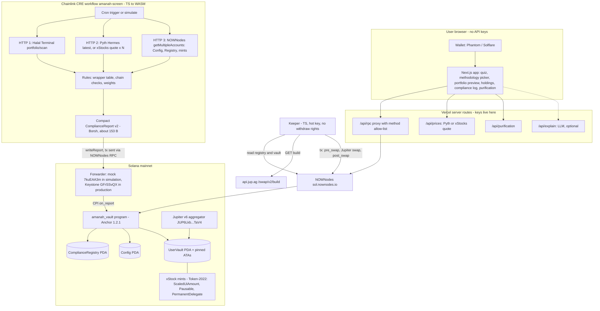
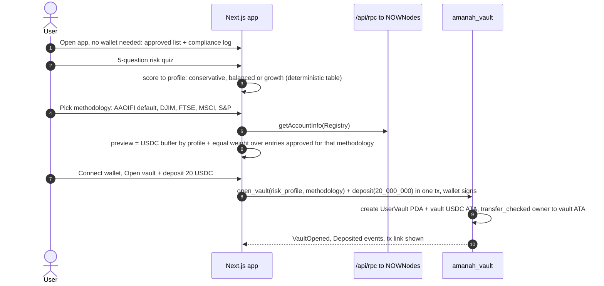
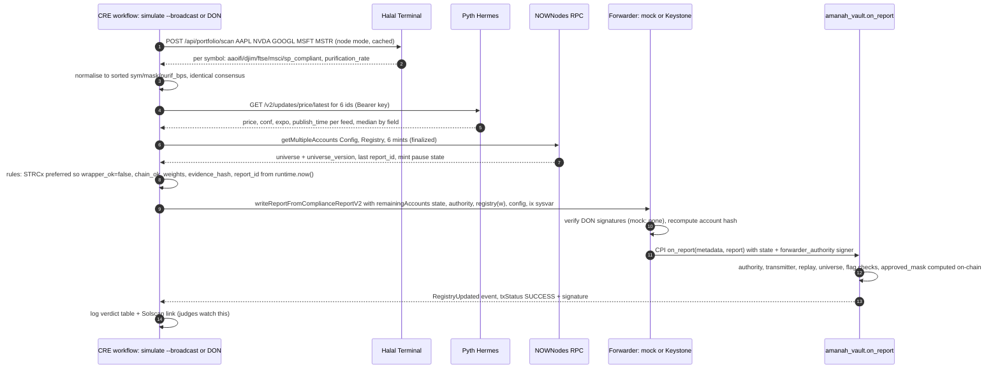
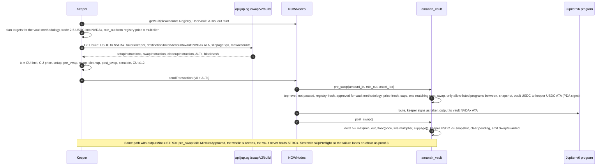
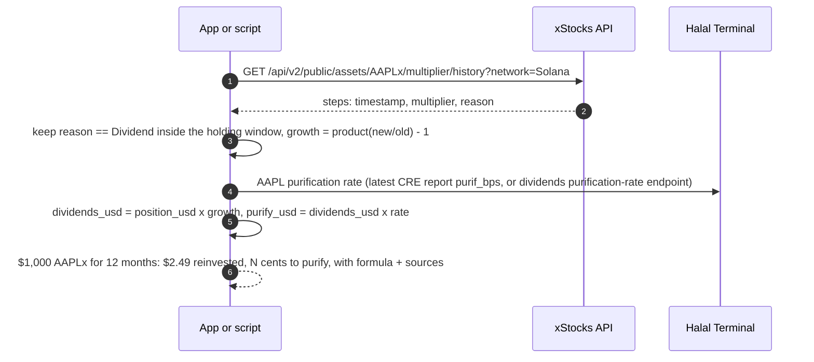
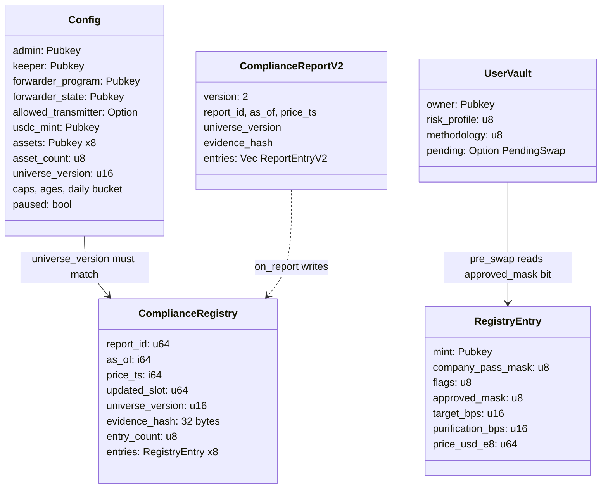

# Amanah: engineering design (rev 3)

*For Haziq · TOKEN2049 Origins, Singapore · written Wed 7 Oct 2026, ~01:00 SGT (UTC+8). All times SGT. Companion files: `requirements.md` (what must be true), `../amanah-build-tasks.md` (who does what, when). This doc supersedes §2–§5 of `amanah-build-tasks.md` rev 2, which now points here.*

> **One line.** A Chainlink CRE workflow screens xStocks on three layers (company to AAOIFI SS21 and four other methodologies, instrument wrapper, token on-chain), writes a compact signed report into an Anchor program's `ComplianceRegistry` through the Keystone (mock) forwarder, and the program's `pre_swap`/`post_swap` guard wraps a Jupiter `/swap/v2/build` route. A swap only lands if the output mint is approved **under the vault owner's chosen methodology**, the route touches only allow-listed programs, and the output clears a fail-closed oracle floor. STRCx fails the instrument layer for every methodology, so `MintNotApproved` is real data, not a staged flip.
>
> Screening results aren't a fatwa. Never write "Shariah-certified" or "halal guaranteed" anywhere (UI, README, deck, video).

**Legend:** ✅ verified tonight against a live doc, API or on-chain read (source in §13) · ⚠️ unverified assumption (the task that checks it is named) · 🆕 new or changed vs build plan rev 2.

---

## 0. What changed vs rev 2, and why (read this first)

Rev 2 (`amanah-build-tasks.md`, Tue 21:05) is still the backbone. These changes come from tonight's verification and from reconciling the brief with deck v3:

| # | Change | Why | Cost |
|---|---|---|---|
| 1 🆕 | **Compact report v2 (≈153 bytes):** `asset_idx` into an admin-set universe instead of 32-byte mints, one report-level `price_ts`, no per-entry multiplier. | ✅ I decoded a real Keystone forwarder tx (devnet): the forwarder instruction is **533 bytes for a 19-byte payload**, so about **514 bytes of fixed overhead** (signatures + 64-byte metadata + context). The rev-2 report (≤565 bytes with 8 mints) would push the forwarder tx to ~1,500 bytes, **over the 1,232-byte legacy/v0 limit**. The payload budget is ≈263 bytes; v2 uses ~153. | +10 min (T04/T07/T11) |
| 2 🆕 | **Methodology bitmask.** Each registry entry carries `company_pass_mask` (one bit per AAOIFI/DJIM/FTSE/MSCI/S&P); `UserVault.methodology` picks one; `pre_swap` checks that bit. | Deck v3 slide 5 promises "You choose your scholar's screening methodology". ✅ Halal Terminal returns `aaoifi_compliant`, `djim_compliant`, `ftse_compliant`, `msci_compliant`, `sp_compliant` per symbol, so it costs one byte and is enforced on-chain. | +20 min |
| 3 🆕 | **Route allow-list between `pre_swap` and `post_swap`:** only Jupiter v6 (`JUP6Lkb…TaV4`), Token, Token-2022 and the ATA program may appear. | Deck v3 slide 5 promises "Blocks: lending · Kamino · Pendle · perps routes". The output-mint check already blocks receiving kTokens/YT/perp positions; the allow-list makes it explicit and testable. | +15 min (T13), +2 tests |
| 4 🆕 | **The transmitter allow-list is feasible.** In the real mock-forwarder tx the transmitter (fee payer) is a **signer account of the top-level forwarder instruction** (position 1 in the mock, position 2 in the Keystone forwarder). `on_report` checks "`allowed_transmitter` is a signer meta of the current top-level instruction, whose program is `config.forwarder_program`", position-agnostic. | Closes roast finding F5 (anyone with the CRE CLI could write our registry through the shared mock forwarder). Production DON transmitters rotate, so the check is an `Option` that gets switched off when moving to Keystone. | T37 shrinks to a confirm-on-mainnet step |
| 5 🆕 | **"AI portfolio" stays deterministic.** Weights = rules (risk profile → USDC buffer; equal weight over mints approved under the chosen methodology). An LLM may only *explain* the computed portfolio (Could, cut first). | Deck v3 slide 5 notes say "no AI agent (the quiz is deterministic)"; roast objection #5. The brief says "AI portfolio". This keeps the word honest without putting an LLM in the decision path. **Your call; say "rules-based portfolio builder" on stage.** | 0 (optional +30) |
| 6 🆕 | **Halal Terminal quota is tiny:** ✅ free plan = **500 tokens and 50 requests per month**; `POST /api/portfolio/scan` costs **15 tokens**, `/api/screen/{symbol}` 5. | About 30 live scans per month in total. Dev runs use a fixture; only stage/proof broadcasts go live. Consider the $19 Starter plan (2,500 tokens / 2,500 requests). | process |
| 7 🆕 | **Transaction version.** The keeper builds **v0 + Jupiter ALTs** (default `/build` output). Fallback if the sandwich is >1,232 bytes: `/build?transactionVersion=1` (4,096 bytes, 64 inline accounts, no ALTs, no ComputeBudget ixs). | ✅ Jupiter `/build` supports `transactionVersion=1`. Per the Solana Foundation `solana-dev` skill, tx v1 activated on mainnet on 2026-09-15 (⚠️ not checked against an explorer or NOWNodes). Readers must pass `maxSupportedTransactionVersion`. | 0 |
| 8 | **NOWNodes:** ✅ `POST https://sol.nownodes.io` + `api-key` header (docs). The key-in-path form (`https://sol.nownodes.io/<key>`) **looks** supported (a dummy path key returns `401 Unknown API_key`, not 404); ⚠️ confirm with a real key. No devnet host found (`sol-devnet.nownodes.io` → 404), so devnet uses the public RPC. | NOWNodes evidence must come from mainnet. | 0 |

Everything else in rev 2 stands: mainnet-first via the CRE mainnet mock forwarder, pinned ATAs, fail-closed floor with per-trade and daily caps, hardened `on_report`, pause switch, real STRCx rejection, three proof links, track order **Chainlink CRE > Solana > NOWNodes (gated)**.

---

## 1. Demo contract: what the deck promises, what must exist

The build must deliver exactly what deck v3 shows. Anything not in this table is optional.

| Deck slide | Promise (on-slide text) | Built by | Evidence on stage |
|---|---|---|---|
| 5 How it works | Quiz sets risk profile; **you choose your scholar's screening methodology**; CRE screens to AAOIFI SS21 on 3 layers; registry changes only via a CRE signed report; token accounts pinned; guard: approved mint, spot only, exact USDC out; after: received ≥ oracle floor (fails closed); **blocks lending · Kamino · Pendle · perps routes**; Halal Terminal, NOWNodes RPC, Pyth price feeds | Program (§5), CRE (§6), app quiz (§8) | Architecture + code; guard tests (T15) named in README |
| 6 Live demo | ① quiz + 20 USDC deposit (balanced) ② CRE run: STRCx fails instrument rule, registry updated on mainnet ③ keeper buys NVDAx via Jupiter in one tx: check · route · check ④ hacked keeper tries STRCx ⑤ fails on-chain `MintNotApproved`; [compliance log] | App (§8), CRE (§6), keeper (§7.5) | Live app + CRE terminal log + Solscan tabs; video fallback after 8 s |
| 7 Proof on mainnet | ① CRE report tx (forwarder → `on_report`) ② guarded swap (`pre_swap` → Jupiter → `post_swap`, above floor) ③ rejected STRCx (`MintNotApproved`); program id; README; QR | T12, T18, T19, T38 | 3 Solscan links that open logged-out |
| 8 Purification | $2.49 on $1,000 AAPLx held 12 months (multiplier 1.000782 → 1.003269, Dividend steps only); **[N] cents** = $2.49 × Halal Terminal purification ratio | `scripts/purification-check.ts` (T24), optional UI card (T40) | Real number on the slide; ratio + source in README |
| 9 Track fit | NOWNodes: "Every Solana read and write, including the CRE report transaction itself"; "only if the cross-check ships: NVDAx's Ethereum multiplier proven to match Solana's" | CRE `project.yaml` RPC + keeper + app proxy all on NOWNodes; T26 gate | NOWNodes dashboard screenshot; README list of calls |
| 10 Caveats | Not a fatwa; tracker-certificate structure disputed; verdicts change; CRE simulator via mock forwarder until deploy access; unaudited, not for US persons | README Limitations | Said out loud |

⚠️ **Demo-hook risk.** The brief says "MSTRx passes". Halal Terminal hasn't been queried for MSTR yet (it needs your key). MSTR carries large convertible debt, so it may fail AAOIFI's debt/market-cap screen even though ShariaQuant rates MSTRX halal. **T01 checks this first.** If MSTR fails AAOIFI, the guarded buy stays NVDAx (as slide 6 already shows), the hook slide keeps ShariaQuant's verdict *as ShariaQuant's*, and the compliance log shows Halal Terminal's per-methodology verdicts honestly. Never pick a methodology just to make a slide work.

---

## 2. Architecture

### 2.1 Components and trust boundaries



**Trust boundaries (who can change what):**

| Actor | Can | Cannot |
|---|---|---|
| CRE workflow (via forwarder) | Replace the registry (approvals, weights, prices) with a newer `report_id` | Move funds; change config; approve an asset outside the admin universe; approve a mint whose wrapper/chain flags are false |
| Admin key | Set keeper, forwarder, transmitter, caps, asset universe (which resets approvals), pause | Approve an asset; move user funds |
| Keeper key | Spend ≤ `max_trade_usdc` per tx and ≤ `max_daily_usdc` per UTC day of vault USDC **into an approved xStock that lands in that vault's ATA at ≥ floor** | Withdraw; choose the output account; buy unapproved mints; route through non-allow-listed programs |
| Vault owner | Deposit, withdraw in kind (also while paused), set risk profile + methodology | Bypass the guard (it applies to keeper swaps; owners can always withdraw and trade elsewhere) |
| Backed (xStock issuer) | Pause the mint; move tokens via the **permanent delegate**; change the multiplier | Nothing we can stop. Disclosed in README Limitations |
| Upgrade authority (deployer) | Replace program code | Hackathon: single key, disclosed. Roadmap: Squads multisig |

### 2.2 Sequence: onboarding (quiz → methodology → deposit)



### 2.3 Sequence: screen (CRE) → registry



### 2.4 Sequence: guarded buy and rejected STRCx



### 2.5 Sequence: purification meter



---

## 3. Solana / Anchor primer for an EVM developer (5-minute read)

| EVM concept | Solana equivalent here | Gotcha |
|---|---|---|
| Contract storage | Separate **accounts**, each owned by a program. Our state = `Config`, `ComplianceRegistry`, `UserVault` | Size is fixed at creation (`space = 8 + INIT_SPACE`); rent-exempt deposit ≈ 0.007 SOL per KB |
| `CREATE2` address | **PDA** = `find_program_address(seeds, program_id)`; no private key; the program "signs" with `seeds + bump` | Always use the **canonical** bump (Anchor `seeds` + `bump` does this); never accept a bump from the client |
| ERC-20 balance mapping | **Token accounts**. The canonical one is the **ATA** = PDA(owner, token_program, mint) under the ATA program | Two token programs: USDC is SPL Token (`Tokenkeg…`), xStocks are **Token-2022** (`TokenzQd…`) ✅. Use `Interface<TokenInterface>` + `InterfaceAccount<…>` and always `transfer_checked` |
| `msg.sender` | **Signer** accounts in the instruction | Anchor `Signer<'info>` + `constraint = key == config.keeper` |
| `onlyOwner` modifier | `has_one = admin` | `#[account(mut)]` is **not** an ownership check (ToB §13) |
| Calling another contract | **CPI**; max depth 4; the callee sees the caller's signer privileges | The forwarder CPIs into `on_report` and passes its PDA as signer |
| Reading the whole tx | **Instructions sysvar** (`Sysvar1nstructions…`): read top-level instructions by index | Only top-level instructions are visible (no CPIs); use forward scans from the current index; `get_stack_height()` tells you whether you were CPI'd |
| Gas | **Compute units** (default 200k per ix, max 1.4M per tx) + priority fee | Jupiter `/build` gives the CU price, not the limit: simulate, ×1.2 |
| Tx size | **1,232 bytes** (legacy/v0); v0 uses Address Lookup Tables; v1 = 4,096 bytes, 64 inline accounts, no ALTs | The forwarder report tx and our swap sandwich are both size-sensitive (§0 #1, §7.5) |
| Events | `emit!` → base64 `Program data:` log lines | Parse with Anchor's `EventParser` (tracks invoke depth) so another program's logs can't spoof ours |
| Upgradable proxy | Programs are upgradable by their **upgrade authority** by default | Deploy needs ~2× program rent temporarily (buffer); `solana program close` the buffer afterwards |
| Token decimals | xStocks: 8 ✅; USDC: 6 | Token-2022 **ScaledUiAmount**: UI amount = raw × multiplier. On-chain math always uses **raw** |

**Anchor 1.x specifics (if you last used 0.29/0.30):** the TS package is `@anchor-lang/core` (not `@coral-xyz/anchor`) ✅; Rust crates `anchor-lang`/`anchor-spl` **1.2.1** ✅ (keep every `anchor-*` crate on the same exact version); `anchor init` scaffolds LiteSVM tests; duplicate mutable accounts are rejected automatically; Anchor 1.2.0 generates a `security.json` template (fill it in: cheap credibility); `avm` can resolve the matching Solana/platform-tools versions from an explicit Anchor version (1.2.0 feature ✅). The Solana SDK crates are on the `^3` line under Anchor 1.x.

---

## 4. Data model overview



Off-chain shared constants live in **`packages/common`** (single source of truth): mints, Pyth feed ids, underlying-ticker map, wrapper table, methodology bit order, forwarder ids, chain selectors, program id, IDL types.

| xStock | Mint (mainnet) ✅ | Company screened | Wrapper | Pyth feed (24/7) ✅ |
|---|---|---|---|---|
| NVDAx | `Xsc9qvGR1efVDFGLrVsmkzv3qi45LTBjeUKSPmx9qEh` | NVDA | common | `4244d078…503b7f` |
| AAPLx | `XsbEhLAtcf6HdfpFZ5xEMdqW8nfAvcsP5bdudRLJzJp` | AAPL | common | `978e6cc6…a58675` |
| GOOGLx | `XsCPL9dNWBMvFtTmwcCA5v3xWPSMEBCszbQdiLLq6aN` | GOOGL | common | `b911b032…b5424e` |
| MSFTx | `XspzcW1PRtgf6Wj92HCiZdjzKCyFekVD8P5Ueh3dRMX` | MSFT | common | `bb723a70…6df3f5` |
| MSTRx | `XsP7xzNPvEHS1m6qfanPUGjNmdnmsLKEoNAnHjdxxyZ` | MSTR | common | `53f95ba4…349c28` |
| STRCx | `Xs78JED6PFZxWc2wCEPspZW9kL3Se5J7L5TChKgsidH` | MSTR | **preferred** (✅ Pyth description: "STRATEGY VARIABLE RATE PERPETUAL STRETCH XSTOCK"; xStocks name "Strategy PP Variable xStock") → `wrapper_ok = false` | `5f5193ed…bc609a47` |

Full Pyth ids are in `amanah-build-tasks.md` (Setup). USDC mint: `EPjFWdd5AufqSSqeM2qN1xzybapC8G4wEGGkZwyTDt1v`.

**Methodology bit order (frozen with report v2):** bit0 AAOIFI (SS21, default) · bit1 DJIM · bit2 FTSE · bit3 MSCI · bit4 S&P. A `null` verdict (insufficient data) = 0, so it fails closed.

---

## 5. Anchor program `amanah_vault`

### 5.1 Accounts (PDAs, seeds, sizes)

Sizes include the 8-byte discriminator. Use `#[derive(InitSpace)]` and assert these numbers in a unit test so a layout change can't slip in.

| Account | Seeds | Fields (bytes) | Size |
|---|---|---|---|
| `Config` | `[b"config"]` | admin 32 · keeper 32 · forwarder_program 32 · forwarder_state 32 · allowed_transmitter `Option<Pubkey>` 33 · usdc_mint 32 · assets `[Pubkey;8]` 256 · asset_count u8 1 · universe_version u16 2 · max_trade_usdc u64 8 · max_daily_usdc u64 8 · daily_spent_usdc u64 8 · day_index i64 8 · max_slippage_bps u16 2 · max_price_age_s u32 4 · max_registry_age_s u32 4 · paused bool 1 · bump u8 1 · _reserved `[u8;32]` 32 | **8 + 528 = 536** |
| `ComplianceRegistry` | `[b"registry"]` | report_id u64 8 · as_of i64 8 · price_ts i64 8 · updated_slot u64 8 · universe_version u16 2 · evidence_hash `[u8;32]` 32 · entry_count u8 1 · entries `[RegistryEntry;8]` 8×47 = 376 · bump u8 1 | **8 + 444 = 452** |
| `RegistryEntry` (type) | n/a | mint 32 · company_pass_mask u8 · flags u8 (bit0 wrapper_ok, bit1 chain_ok) · approved_mask u8 (computed on-chain) · target_bps u16 · purification_bps u16 · price_usd_e8 u64 | 47 |
| `UserVault` | `[b"vault", owner]` | owner 32 · risk_profile u8 1 · methodology u8 1 · pending `Option<PendingSwap>` 1+66 · bump u8 1 · _reserved `[u8;16]` 16 | **8 + 118 = 126** |
| `PendingSwap` (type) | n/a | out_mint 32 · amount_in u64 8 · min_out u64 8 · out_before u64 8 · keeper_usdc_before u64 8 · asset_idx u8 1 · pre_ix_index u8 1 | 66 |
| Vault USDC ATA | ATA(user_vault, USDC, SPL Token) | standard | 165 |
| Vault xStock ATA | ATA(user_vault, xStock, Token-2022) | Token-2022 account + required account extensions | ⚠️ ~170–200; let the ATA program size it, never hard-code rent |

Rent for the two global PDAs ≈ 0.007 SOL. Each new vault ≈ 0.003 SOL (vault + USDC ATA), plus ≈ 0.002 SOL per xStock ATA.

### 5.2 Report format (CRE → `on_report`), frozen at `version = 2`

Borsh, little-endian. **The struct must be referenced by an event (or account) so it lands in the IDL.** Anchor drops types only used as raw `bytes`, and CRE's binding generator needs the type to produce `writeReportFromComplianceReportV2` ✅ (docs note).

| Field | Type | Bytes | Rule enforced on-chain |
|---|---|---|---|
| `version` | u8 | 1 | `== 2` |
| `report_id` | u64 | 8 | `> registry.report_id` (replay) |
| `as_of` | i64 | 8 | `≤ now + 60` (future) and `≥ now − max_registry_age_s` (stale on arrival) |
| `price_ts` | i64 | 8 | min `publish_time` across feeds; `≤ now + 60` |
| `universe_version` | u16 | 2 | `== config.universe_version` |
| `evidence_hash` | `[u8;32]` | 32 | stored + emitted (sha256 of the normalised screening array) |
| `entries` | `Vec<ReportEntryV2>` | 4 + 15·n | `n ≤ config.asset_count ≤ 8`; `asset_idx` strictly increasing (unique, sorted) |
| ↳ `asset_idx` | u8 | 1 | `< config.asset_count`; mint resolved from `config.assets` |
| ↳ `company_pass_mask` | u8 | 1 | reserved bits (5–7) zero |
| ↳ `flags` | u8 | 1 | bit0 wrapper_ok, bit1 chain_ok, other bits zero |
| ↳ `target_bps` | u16 | 2 | `> 0` only if `approved_mask != 0`; Σ ∈ {0, 10000} (0 = freeze all buys) |
| ↳ `purification_bps` | u16 | 2 | ≤ 10000 |
| ↳ `price_usd_e8` | u64 | 8 | 0 allowed (= no price, so the guard rejects buys of that asset) |

Size with 6 assets: 1+8+8+8+2+32+4 + 6×15 = **153 bytes**. ✅ Budget: the measured forwarder overhead is 514 bytes on top of the payload; with ~10 account keys and 2 ComputeBudget ixs the forwarder tx is ≈ 969 + payload bytes, so the payload must stay **≤ ~263 bytes**. ⚠️ A mainnet DON may attach more signatures than the devnet sample (65 bytes each). T12 logs the real size; if it's tight, drop `evidence_hash` from the report (keep it in the CRE log) to free 32 bytes.

`approved_mask` is **computed on-chain**: `if wrapper_ok && chain_ok { company_pass_mask } else { 0 }`. The report carries no trusted "approved" flag.

### 5.3 Instructions

Error codes are Anchor custom errors starting at 6000. Freeze the order after T04 so `MintNotApproved` keeps its number in slides and README.

| Instruction | Signer | Key accounts | Checks → effects | Errors |
|---|---|---|---|---|
| `initialize(params)` | admin (payer) | config (init), registry (init) | keeper ≠ admin; caps > 0; `max_slippage_bps ≤ 1000` → create PDAs | `InvalidParams` |
| `set_assets(mints)` 🆕 | admin | config, registry (mut), mints as remaining accounts | ≤ 8; unique; each owned by Token-2022 with a ScaledUiAmount extension → write `assets`, `universe_version += 1`, **clear registry entries** (approvals reset), emit `ConfigChanged` | `InvalidParams`, `NotToken2022` |
| `set_keeper` / `set_forwarder` / `set_transmitter` / `set_params` / `set_paused` | admin | config | `has_one = admin` → update, emit `ConfigChanged{field, old, new}` | `Unauthorized` |
| `open_vault(risk_profile, methodology)` | owner (payer) | user_vault (init), vault_usdc_ata (init_if_needed, pinned), usdc_mint, token_program, associated_token_program, system_program | `risk_profile ≤ 2`, `methodology ≤ 4` → create | `InvalidParams` |
| `set_profile(risk_profile, methodology)` 🆕 | owner | user_vault | `has_one = owner`; no pending | `SwapPending` |
| `deposit(amount)` | owner | owner_usdc_ata, vault_usdc_ata (pinned), usdc_mint == config.usdc_mint, token_program == mint owner | not paused; amount > 0 → `transfer_checked` | `Paused`, `InvalidMint` |
| `withdraw(amount)` | owner | user_vault, vault_ata (pinned to `mint`), owner_ata, mint, token_program | `has_one = owner`; no pending; **allowed while paused** → PDA-signed `transfer_checked` | `SwapPending`, `Unauthorized`, `AssetPaused` (maps the Token-2022 Pausable error) |
| `on_report(metadata: Vec<u8>, report: Vec<u8>)` | `forwarder_authority` (PDA signer via CPI) | `state`, `forwarder_authority` (supplied by the forwarder), then `registry` (w), `config`, `instructions` sysvar (address-constrained) | §5.4 | `InvalidForwarderState`, `InvalidForwarderAuthority`, `UnknownTransmitter`, `InvalidReport`, `StaleReport`, `FutureReport`, `UniverseMismatch` |
| `pre_swap(amount_in, min_out, asset_idx)` | keeper | config (mut), registry, user_vault (mut), vault_usdc_ata, keeper_usdc_ata, usdc_mint, out_mint, vault_out_ata, usdc_token_program, out_token_program, instructions sysvar | §5.5 | `NotTopLevel`, `Paused`, `MintNotApproved`, `RegistryStale`, `PriceMissing`, `PriceStale`, `TradeTooLarge`, `DailyCapExceeded`, `SwapPending`, `MissingPostSwap`, `RouteNotAllowed` 🆕, `InvalidMint` |
| `post_swap()` | keeper | same accounts as `pre_swap` | §5.5 | `NotTopLevel`, `NoPendingSwap`, `SlippageExceeded`, `PriceMissing`, `PriceStale`, `KeeperKeptFunds` 🆕 |

**Frozen error order (6000+):** `Unauthorized, InvalidParams, Paused, InvalidMint, NotToken2022, SwapPending, NoPendingSwap, InvalidForwarderState, InvalidForwarderAuthority, UnknownTransmitter, InvalidReport, StaleReport, FutureReport, UniverseMismatch, MintNotApproved, RegistryStale, PriceMissing, PriceStale, TradeTooLarge, DailyCapExceeded, MissingPostSwap, RouteNotAllowed, NotTopLevel, SlippageExceeded, KeeperKeptFunds, AssetPaused, MathOverflow`. With this order `MintNotApproved = 6014` (0x177e); print the real value from the IDL into the README.

**Events:** `RegistryUpdated { report_id, as_of, price_ts, universe_version, evidence_hash, entries (mints resolved), metadata_len, transmitter }` (also pulls `ComplianceReportV2` into the IDL) · `SwapGuarded { vault, out_mint, amount_in, out, floor, price_usd_e8, multiplier_e12, methodology }` · `VaultOpened`, `Deposited`, `Withdrawn`, `ConfigChanged`.

### 5.4 `on_report` checks (hardened)

1. `state.key() == config.forwarder_state` **and** `*state.owner == config.forwarder_program` (roast F3).
2. `forwarder_authority.key() == Pubkey::find_program_address(&[b"forwarder", state.key().as_ref(), crate::ID.as_ref()], &config.forwarder_program).0` and `forwarder_authority.is_signer` (canonical bump, never passed in). ✅ The derivation matches the CRE docs.
3. 🆕 If `config.allowed_transmitter == Some(t)`: `let idx = load_current_index_checked(ix_sysvar)?; let ix = load_instruction_at_checked(idx as usize, ix_sysvar)?;` require `ix.program_id == config.forwarder_program` and `ix.accounts.iter().any(|m| m.pubkey == t && m.is_signer)`, else `UnknownTransmitter`. ✅ Evidence: mock tx `c8ifuiha…` forwarder ix accounts = [state, **transmitter (signer)**, authority, receiver, system]; Keystone tx `2dJiCNgb…` has the transmitter at position 2. The position-agnostic check covers both.
4. Borsh-decode `ComplianceReportV2`; `version == 2`; `report.len() ≤ 300`.
5. `report_id > registry.report_id`; `as_of ≤ now + 60`; `as_of ≥ now − max_registry_age_s`; `price_ts ≤ now + 60`.
6. `universe_version == config.universe_version`; `n ≤ asset_count`; `asset_idx` strictly increasing and `< asset_count`; reserved bits zero; Σ`target_bps` ∈ {0, 10000}; `target_bps > 0 ⇒ approved_mask ≠ 0`.
7. Write the registry (entries resolved to mints from `config.assets`), `updated_slot = Clock::slot`; `msg!` the metadata length and its first 32 bytes (the workflow id on Keystone); emit `RegistryUpdated`.

### 5.5 The guard: `pre_swap` / `post_swap`

**`pre_swap(amount_in, min_out, asset_idx)`**

1. `get_stack_height() == TRANSACTION_LEVEL_STACK_HEIGHT` (blocks CPI wrapping), else `NotTopLevel`.
2. `keeper.key() == config.keeper`; `!config.paused`; `user_vault.pending.is_none()`.
3. `asset_idx < registry.entry_count`; `entry.mint == out_mint.key()`; `entry.approved_mask & (1 << user_vault.methodology) != 0`, else **`MintNotApproved`**.
4. `now − registry.as_of ≤ max_registry_age_s` (`RegistryStale`); `entry.price_usd_e8 > 0` (`PriceMissing`); `now − registry.price_ts ≤ max_price_age_s` (`PriceStale`).
5. `amount_in ≤ max_trade_usdc` (`TradeTooLarge`); roll `day_index = now / 86400` (reset `daily_spent_usdc` when it changes); `daily_spent_usdc + amount_in ≤ max_daily_usdc` (`DailyCapExceeded`).
6. **Account pinning** (Anchor constraints): `vault_usdc_ata` = ATA(user_vault, usdc_mint, usdc_token_program); `vault_out_ata` = ATA(user_vault, out_mint, out_token_program); `keeper_usdc_ata` = ATA(keeper, usdc_mint, usdc_token_program); `usdc_mint == config.usdc_mint`; `usdc_token_program.key() == *usdc_mint.owner`; `out_token_program.key() == *out_mint.owner == Token-2022`; instructions sysvar `address = sysvar::instructions::ID`.
7. **Forward scan** from `load_current_index_checked`, using `load_instruction_at_checked(i)` for i = current+1 onwards until a `post_swap` is found:
   - every instruction in between must have `program_id ∈ {JUP6LkbZbjS1jKKwapdHNy74zcZ3tLUZoi5QNyVTaV4, Token, Token-2022, ATA program}`, else **`RouteNotAllowed`** 🆕 (this is what blocks Kamino/lending/perps/Pendle-style programs at the top level);
   - a `pre_swap` (our program id + `pre_swap` discriminator) for the same `user_vault` before the `post_swap` → `SwapPending`;
   - the `post_swap` must be ours (program id + discriminator) with the **same `user_vault` and `vault_out_ata`** at their account positions; exactly one; none → `MissingPostSwap`.
8. Snapshot `out_before = vault_out_ata.amount`, `keeper_usdc_before = keeper_usdc_ata.amount`; set `pending`; `daily_spent_usdc += amount_in`; PDA-signed `transfer_checked(vault_usdc_ata → keeper_usdc_ata, amount_in)`.

**`post_swap()`**

1. Top-level only; `pending.is_some()`; `out_mint == pending.out_mint`; same pinned accounts (re-validated by constraints).
2. `reload()` both token accounts.
3. Read the **effective multiplier from the mint**: Token-2022 TLV extension type 25 (`ScaledUiAmount`) ✅ = `{authority 32, multiplier f64, new_multiplier_effective_timestamp i64, new_multiplier f64}` ✅; `m = if now ≥ ts { new_multiplier } else { multiplier }`; `m_e12 = (m * 1e12) as u128` (reject non-finite or ≤ 0).
4. Floor (u128 checked math, rounds down):
   `raw_expected = amount_in × 10^2 × 10^8 × 10^12 / (price_usd_e8 × m_e12)` (USDC 6 dp → USD e8 is ×10²; xStock 8 dp)
   `floor = raw_expected × (10000 − max_slippage_bps) / 10000`
   ⚠️ This assumes Pyth `Crypto.<X>X/USD` prices **one UI token**. T01 confirms against a $5 Jupiter quote; if the feed prices the raw token, drop `m_e12` (a one-line change, decided before T14).
5. `delta = vault_out_ata.amount − out_before ≥ max(min_out, floor)`, else `SlippageExceeded`. A missing or stale price **rejects** (never skips).
6. `keeper_usdc_ata.amount ≤ keeper_usdc_before` (the snapshot from before `pre_swap`'s transfer), else `KeeperKeptFunds`. Jupiter ExactIn spends the full `amount_in`, so the keeper ends with no more USDC than it started with.
7. Clear `pending`; emit `SwapGuarded`.

### 5.6 Scaffold snippets (not product code)

```rust
// programs/amanah-vault/Cargo.toml: pin exact versions
// anchor-lang = { version = "=1.2.1", features = ["init-if-needed"] }
// anchor-spl  = { version = "=1.2.1", features = ["token", "token_2022", "associated_token"] }
// If anchor_lang::solana_program::sysvar::instructions lacks the *_checked helpers in 1.2.x,
// add the `solana-instructions-sysvar` crate on the ^3 line (check `cargo tree -d` for duplicates).

#[derive(Accounts)]
pub struct OnReport<'info> {
    /// CHECK: key and owner checked against config in the handler
    pub state: UncheckedAccount<'info>,
    pub forwarder_authority: Signer<'info>,
    #[account(mut, seeds = [b"registry"], bump = registry.bump)]
    pub registry: Account<'info, ComplianceRegistry>,
    #[account(seeds = [b"config"], bump = config.bump)]
    pub config: Account<'info, Config>,
    /// CHECK: address-constrained
    #[account(address = anchor_lang::solana_program::sysvar::instructions::ID)]
    pub instructions: UncheckedAccount<'info>,
}

// Effective ScaledUiAmount multiplier, hand-parsed TLV (avoids coupling to an spl-token-2022 crate version).
// Mint base = 82 bytes, padded to 165, then 1 byte AccountType (1 = Mint), then TLV entries [u16 type][u16 len][data].
fn effective_multiplier_e12(mint_data: &[u8], now: i64) -> Result<u128> {
    const SCALED_UI_AMOUNT: u16 = 25;
    let mut i = 166usize;
    while i + 4 <= mint_data.len() {
        let t = u16::from_le_bytes([mint_data[i], mint_data[i + 1]]);
        let l = u16::from_le_bytes([mint_data[i + 2], mint_data[i + 3]]) as usize;
        require!(i + 4 + l <= mint_data.len(), VaultError::InvalidMint);
        let d = &mint_data[i + 4..i + 4 + l];
        if t == SCALED_UI_AMOUNT {
            require!(l >= 56, VaultError::InvalidMint);
            let m  = f64::from_le_bytes(d[32..40].try_into().unwrap());
            let ts = i64::from_le_bytes(d[40..48].try_into().unwrap());
            let nm = f64::from_le_bytes(d[48..56].try_into().unwrap());
            let eff = if now >= ts { nm } else { m };
            require!(eff.is_finite() && eff > 0.0, VaultError::InvalidMint);
            return Ok((eff * 1e12) as u128);
        }
        if t == 0 { break; }
        i += 4 + l;
    }
    err!(VaultError::InvalidMint)
}
```

Unit-test the parser against the real AAPLx mint bytes. ✅ jsonParsed today: `multiplier 1.0026642075893797`, `newMultiplier 1.0032690125398187`, `newMultiplierEffectiveTimestamp 1786149000` (8 Aug 2026 00:30 UTC), so the effective value now is 1.003269. Fetch with `getAccountInfo(…, {encoding: "base64"})` and commit it as a fixture.

### 5.7 Compute and cost budget

| Item | Estimate | How to confirm |
|---|---|---|
| `on_report` | 20–40k CU (Borsh decode + 8-entry write + sysvar read) | CRE `computeLimit: 300_000` leaves room; ✅ the docs receiver used 6.8–9.8k CU |
| `pre_swap` | 30–60k CU (the forward scan deserialises each later ix) | `simulateTransaction` in T18 |
| `post_swap` | 20–40k CU (TLV + f64 soft-float + u128) | same |
| Jupiter route | 150–400k CU | `/build` + simulate ×1.2, cap 1.4M |
| Program deploy | `solana rent $(stat -c%s target/deploy/amanah_vault.so)` ≈ 0.007 SOL per KB; ~2× during deploy (buffer) | T08; close buffers only after judging |

---

## 6. Chainlink CRE workflow `amanah-screen`

### 6.1 Facts the design relies on (✅ CRE docs, local mirror + live `onchain-write-ts` page, updated 2026-08-20)

- **Solana is write-only** in CRE: no Solana read capability, so reads go over HTTP JSON-RPC (NOWNodes). Writes go through the `SolanaClient` → forwarder → `on_report` CPI.
- Forwarder program ids: **mock** `7kuEAA3mSC1Tz8gQjnvH7bKFda9xSPRRin9SZbH49cNK` (simulation; mock state mainnet `jhCjuD4Z3V7HeSUChMRpkRwpw6B9yC63mxDMv8SdLNX`, devnet `5Tipz3yhTBdVsDbaBxZkrp7Gjf3brGq5SKkxReefPMP7`); **Keystone** mainnet `GFrSSvQXaVGkc6Nrr8y2msie6pivJkR1s2EnDk4et294` (state `9FgdPyU28bGMCuJyD34pzw9W7Ys36ziLbT9cbZtsaraV`), devnet `CXsKEJcs25TQEYU2e5jZ8QTPE3ffMLZhH6BWHrdcCCB5` (state `8QoomCQyPSkJ8WopJbX9B4HyvrFzziwvJdU8hZE6DCr9`).
- Chain selectors: Solana mainnet `124615329519749607`, devnet `16423721717087811551`.
- `remainingAccounts` order = `[forwarderState, forwarderAuthority, …receiver accounts]`; the forwarder hashes them (sha256), and a mismatch gives `Custom:6002 InvalidAccountHash`. Default compute limit 290k. `txStatus == 2` means SUCCESS. Generated bindings expose `writeReportFrom<StructName>()`.
- Quotas (✅ 16 Sep 2026): **15 HTTP calls per run**, 250 KB response, 120 KB request, responses cacheable for 10 min, **5 secrets**, consensus payload 25 KB / 50 calls, run timeout 5 min, cron ≥ 30 s, log line 1 KB, 3 workflows on the private registry. `cre workflow simulate … --limits default` enforces the deployed limits locally. Confidential HTTP exists (hides the request from nodes).
- Simulation needs `CRE_ETH_PRIVATE_KEY` set to any EVM key (even for Solana-only workflows) and `CRE_SOLANA_PRIVATE_KEY` (the transmitter; pays fees). CLI ≥ 1.29 for Solana; current CLI **1.36.0** (1 Oct 2026); `@chainlink/cre-sdk` **1.23.0**.
- Deploy to the DON needs early access, requested with `cre account access`. **Plan on the simulator + mock forwarder** and frame it honestly (§6.5).

### 6.2 Steps and HTTP budget

| Step | Capability | Call | HTTP count | Consensus | Notes |
|---|---|---|---|---|---|
| 1 Trigger | Cron (`0 */6 * * *` on deploy) / manual simulate | n/a | 0 | n/a | `runtime.now()` is the only clock (determinism) |
| 2 Screen | HTTP in `runInNodeMode` | `POST https://api.halalterminal.com/api/portfolio/scan` `{symbols:[AAPL,NVDA,GOOGL,MSFT,MSTR]}` with `X-API-Key` (secret) | 1 | `consensusIdenticalAggregation` over a **normalised, sorted** `[{sym, mask, purif_bps}]` | `cacheSettings` max-age 600 s; ✅ 15 tokens per call; ⚠️ host path and `purification_rate` units confirmed in T01 |
| 3 Prices | HTTP | `GET {PYTH_HERMES}/v2/updates/price/latest?ids[]=…×6&parsed=true` with `Authorization: Bearer` | 1 | `ConsensusAggregationByFields` median per price; `price_ts = min(publish_time)` | Fallback (no Pyth key): `GET api.xstocks.fi/api/v2/public/assets/{SYM}/price-data` × 6 = 6 calls. Zero a price when `conf/price > 2%` |
| 4 Chain state | HTTP JSON-RPC | `POST https://sol.nownodes.io` (`api-key` header) `getMultipleAccounts([config, registry, 6 mints], {encoding:"base64", commitment:"finalized"})` | 1 | identical on decoded fields | universe + `universe_version`, last `report_id`, mint `paused`, ScaledUiAmount present |
| 5 Rules | pure TS | n/a | 0 | n/a | wrapper table (STRCx preferred → `wrapper_ok=false`); `chain_ok` = Token-2022 + not paused + routable list from T01; equal weight over AAOIFI-approved (target is informational; the keeper recomputes per methodology); `report_id = max(now_ms, last+1)`; `evidence_hash = sha256(normalised array)` |
| 6 Write | `SolanaClient.writeReport` | forwarder → `on_report` (tx via NOWNodes RPC in `project.yaml`) | 0 | DON-signed report (mock: unsigned) | `remainingAccounts`: state, authority, registry (w), config, instructions sysvar; `computeLimit: 300_000` |
| 7 Log | `runtime.log` | n/a | 0 | n/a | verdict table + `https://solscan.io/tx/<sig>`; ≤ 1 KB per line |

**Total: 3 HTTP calls** (8 with the xStocks fallback), well under 15. Extra optional calls (T26 Ethereum cross-check: +2) still fit.

**Determinism rules (CRE best practice):** never `Date.now()` or `new Date()` (grep gate in T11); sort object keys and arrays before consensus; integers only (bps, e8) after normalisation; no `Math.random`.

### 6.3 Config and secrets

```
cre-workflow/
  project.yaml        # rpcs: solana-mainnet -> NOWNodes URL (key via env), solana-devnet -> public RPC
  secrets.yaml        # HALAL_TERMINAL_API_KEY, PYTH_API_KEY, NOWNODES_API_KEY (3 of 5)
  amanah-screen/
    workflow.yaml     # name, config paths per target (local-simulation, staging, production)
    config.mainnet.json   # programId, configPda, registryPda, forwarder ids, chainSelector, feed ids, universe
    main.ts           # handler wiring
    steps/{screen,prices,chain,rules,report}.ts
    bindings/         # generated from target/idl/amanah_vault.json (cre generate-bindings, ⚠️ exact command in T09)
    fixtures/halal-scan.json   # dev runs, saves Halal Terminal tokens
```

⚠️ Whether `project.yaml` RPC URLs can take a custom header (`api-key`) or need the key-in-path form is **unverified**. T12 tries the header first, then `https://sol.nownodes.io/<key>`, otherwise a public RPC for the write while NOWNodes stays on reads (and slide 9 wording is adjusted).

### 6.4 Commands

| Purpose | Command | Who |
|---|---|---|
| Dev loop (fixture, devnet) | `cre workflow simulate amanah-screen --target local-simulation` | agent or you |
| Limits check | `cre workflow simulate amanah-screen --target staging --limits default` | agent or you |
| **Mainnet proof write** | `cre workflow simulate amanah-screen --target production --broadcast` (mock forwarder, mainnet) | **you, by hand** (moves mainnet SOL, writes the live registry) |
| Deploy access | `cre account access` (request), then `cre workflow deploy amanah-screen --target production` if granted | you |

### 6.5 Simulation vs deploy: what we claim

- **Built and shown:** a CRE TS workflow that runs in the official simulator with `--broadcast`, producing a **real mainnet transaction** through Chainlink's mock forwarder into our program. The receiver enforces forwarder state, owner, derived authority, replay and an allow-listed transmitter.
- **Not claimed:** DON consensus or DON signatures on mainnet. The mock forwarder doesn't verify signatures; that is exactly why `allowed_transmitter` exists.
- **Upgrade path:** `set_forwarder(Keystone ids)` + `set_transmitter(None)`; same code. If deploy access lands before Thu, record one DON run (stretch, not on the critical path).

---

## 7. Off-chain services

### 7.1 Portfolio builder (deterministic; "AI" only explains)

```
profile  = quiz_score <= 4 ? conservative : quiz_score <= 8 ? balanced : growth   // 5 Qs scored 0-2
buffer   = {conservative: 4000, balanced: 2000, growth: 500}[profile]          // bps kept in USDC
eligible = registry.entries.filter(e => e.approved_mask & (1 << methodology) && e.price_usd_e8 > 0)
weight_i = floor((10000 - buffer) / eligible.length); remainder goes to the USDC buffer
```

Same function in `packages/common/portfolio.ts`, used by the app preview and the keeper. Optional `/api/explain` (Could): sends `{profile, methodology, weights, verdicts}` to an LLM and shows a 3-sentence explanation **labelled "AI explanation; weights are rule-based"**.

### 7.2 Screening source

Halal Terminal (✅ OpenAPI): `X-API-Key`; free key via `POST /api/keys/generate {email}`; `ScreeningResultResponse` gives `aaoifi_compliant | djim_compliant | ftse_compliant | msci_compliant | sp_compliant` (`null` = insufficient data → 0), `purification_rate`, `compliance_explanation`, `debt_to_market_cap_ratio`. Portfolio scan takes ≤ 100 symbols. ⚠️ `purification_rate` units are ambiguous in the schema examples (0.42 / 0.025 / "0.031 = 3.1%"); T01 pins it by comparing against `compliance_explanation`, and the normaliser converts to bps with a unit test. Alternative if the key fails: Zoya/Musaffa APIs (⚠️ unverified access) or a committed, dated fixture labelled "cached screening" (honest fallback).

### 7.3 Prices

Pyth Hermes with a Bearer key (✅ the unauthenticated `/v2/updates/price/latest` returns 401 on both `pyth.dourolabs.app/hermes` and `hermes.pyth.network`; the base URL for keyed access is ⚠️ confirmed in T03 from the key email/portal). Fallback: the xStocks public quote (✅ keyless; AAPLx `{"quote":331.8}` tonight; ⚠️ units vs UI token checked in T01).

### 7.4 NOWNodes usage (track evidence)

| Caller | Methods | Host |
|---|---|---|
| CRE step 4 | `getMultipleAccounts` | `sol.nownodes.io` |
| CRE write (project.yaml RPC) | `getLatestBlockhash`, `sendTransaction`, `getSignatureStatuses` (inside the CRE runtime) | `sol.nownodes.io` ⚠️ (§6.3) |
| Keeper | `getMultipleAccounts`, `getLatestBlockhash`, `simulateTransaction`, `sendTransaction`, `getSignatureStatuses`, `getAddressLookupTable` (via `getAccountInfo`) | `sol.nownodes.io` |
| App `/api/rpc` | allow-list: `getAccountInfo`, `getMultipleAccounts`, `getTokenAccountsByOwner`, `getLatestBlockhash`, `sendTransaction`, `getSignatureStatuses`, `getTransaction`, `simulateTransaction` | `sol.nownodes.io` |
| T26 (cut) | `eth_call` on NVDAx (Ethereum) multiplier | `eth.nownodes.io` ✅ host answers (422 without key) |

Usage at demo scale: ~2k requests per day, well inside the ✅ START plan (100K requests per month). Poll confirmations every 1.5 s (no WebSocket dependency; ✅ `wss://sol.nownodes.io/wss` answered 426 to plain HTTPS, so ⚠️ WS is untested).

### 7.5 Keeper (TS, `keeper/`)

1. Load registry, vault, ATAs (one `getMultipleAccounts`). Compute targets with `portfolio.ts` for the vault's methodology; pick the largest underweight asset; `amount_in = min(gap, max_trade_usdc)`.
2. `min_out = floor(amount_in × 1e2 × 1e8 × 1e12 / (price_e8 × m_e12) × (10000 − slippage) / 10000)` (same formula as on-chain).
3. `GET https://api.jup.ag/swap/v2/build?inputMint=USDC&outputMint=<xStock>&amount=<amount_in>&taker=<keeper>&destinationTokenAccount=<vault ATA>&slippageBps=<bps>&maxAccounts=<n>` with `x-api-key` ✅ (params and response fields verified against the Jupiter skill + docs; no platform fee).
4. Assemble: `[ComputeBudget limit, ComputeBudget price (from computeBudgetInstructions)] + setupInstructions + pre_swap + swapInstruction + cleanupInstruction + post_swap` (otherInstructions/tip are ignored; ⚠️ if `/build` returns `otherInstructions` the allow-list must cover them or we drop them). v0 message with `addressesByLookupTableAddress`.
5. `simulateTransaction` → CU × 1.2 (cap 1.4M) → re-sign → send via NOWNodes → poll.
6. If serialised size > 1,232 bytes: step down `maxAccounts` (64 → 40 → 30 → 20); if still too big, `transactionVersion=1` (⚠️ needs v1 live on mainnet and wallet/explorer support, so check T01).

Note: setup instructions may create the keeper's own ATAs (ATA program, allow-listed). Jupiter's shared-accounts route uses Token/Token-2022 CPIs inside the v6 program; those are inner instructions and don't hit our top-level scan.

### 7.6 Purification

`growth = Π(m_new/m_old over Dividend steps in window) − 1`; `dividends_usd = position_usd × growth`; `purify_usd = dividends_usd × purification_rate`. ✅ AAPLx, 6 Oct 2025 → 6 Oct 2026: 1.000782 → 1.003269 = +0.2485%, so **$2.49 on $1,000**. [N] cents = $2.49 × AAPL's Halal Terminal purification rate (T24 fills the slide). The meter always shows the formula and sources and labels the result "estimate; confirm with your scholar".

---

## 8. Frontend (Next.js App Router, `app/`)

| Route | Content | Data |
|---|---|---|
| `/` | Hero + **live approved list per methodology** + latest report (report_id, age, Solscan link); works without a wallet | registry via `/api/rpc` |
| `/start` | 5-question quiz → profile; methodology picker (AAOIFI default, the others with one-line descriptions); portfolio preview | `portfolio.ts` |
| `/vault` | Connect wallet; `open_vault` + `deposit` in one tx; holdings at the **effective** multiplier (UI amount = raw × m); withdraw | wallet + `/api/rpc` |
| `/log` | Compliance log: per asset × methodology verdict, wrapper/chain flags, report history (`RegistryUpdated` events), keeper `SwapGuarded` events, rejected attempts (from `docs/proof.md`) | `getSignaturesForAddress` → `getTransaction`, parsed with Anchor `EventParser` |
| `/purify` | Purification card: per holding, dividends since deposit, amount to purify, formula + sources | `/api/purification` |

**Wallet flow:** `@solana/wallet-adapter-react` (Phantom, Solflare) + `@anchor-lang/core` `Program` built from the IDL; the connection points at `/api/rpc` (server route forwards to NOWNodes with the header; keys never reach the browser). Confirmations by polling `getSignatureStatuses`. Error mapping: Anchor error code → friendly copy (e.g. 6014 → "This token isn't approved under your chosen methodology"); unknown errors show the raw log and Solscan link.

**Copy rules:** "screened by Halal Terminal data under <methodology>", "not a fatwa", "unaudited hackathon code", never "certified".

---

## 9. Security design

Applied checklists: Solana Foundation `solana-dev` `references/security.md` (program, client, Token-2022 sections), Trail of Bits `solana-vulnerability-scanner` (6 patterns), solana-new `review-and-iterate`, roast §3 (F1–F5) and §6.8 (C1–C9).

### 9.1 Trust model in one paragraph

Funds sit in PDA-owned ATAs per user. Only the **owner** can withdraw. The **keeper** can only spend capped USDC into an **approved** xStock that lands **in that vault** at **≥ oracle floor**, through **allow-listed programs**, and must end the tx with no extra USDC. The **registry** can only change through `on_report`, called by the configured forwarder's derived PDA, from the allowed transmitter (while on the mock), with a strictly increasing `report_id`, inside the admin-set universe. Approval itself is computed on-chain from flags. The **admin** can pause buys, change the keeper/forwarder/caps and reset the universe, but can't approve assets or touch funds. Residual risks: the upgrade authority, Backed's permanent delegate and pause power, Halal Terminal data correctness, and the mock forwarder's lack of DON signatures.

### 9.2 Threat table

| # | Threat | Vector | Control | Test (T15/T37) | Residual |
|---|---|---|---|---|---|
| 1 | Keeper redirects output to itself | Passes its own xStock account as `vault_out_ata` | ATA constraints (mint, authority = user_vault, token program) on `pre_swap` and `post_swap`; `post_swap` must match the same accounts | `keeper_own_ata_as_vault_out` fails | none |
| 2 | Keeper buys at a bad price (self-sandwich) | Manipulated pool + `min_out = 1` | Floor from registry price × live multiplier, fails closed; per-trade + daily caps | `low_output_20pct`, `stale_price`, `zero_price` | ≤ slippage × daily cap per day |
| 3 | Keeper keeps USDC | Partial route; skims the transfer | `KeeperKeptFunds`: keeper USDC after ≤ snapshot | `keeper_keeps_usdc` (mock-route program) | none |
| 4 | Keeper buys an unapproved / non-halal mint | Hacked keeper targets STRCx | `MintNotApproved` (methodology bit); approval computed on-chain | `strcx_rejected`, `methodology_bit_respected` | none |
| 5 | Lending/LP/perps/Pendle positions | Route through Kamino etc. or output a receipt token | Output must be an approved xStock mint; **route allow-list** between pre and post | `route_not_allowed` (mock-route program id not on the list) | Jupiter inner CPIs are trusted (we can't see inner ixs) |
| 6 | Guard skipped | `pre_swap` without `post_swap`, or a `post_swap` for another vault | Forward scan: exactly one matching `post_swap` (program + discriminator + user_vault + vault_out_ata) | `missing_post_swap`, `post_swap_other_vault`, `double_pre_swap` | none |
| 7 | Guard wrapped by CPI | Attacker program CPIs `pre_swap`, then manipulates state | `get_stack_height() == TRANSACTION_LEVEL_STACK_HEIGHT` in both | `cpi_wrapped_pre_swap` | none |
| 8 | Fake forwarder state | Attacker passes their own `state` account | `state == config.forwarder_state` and owner == forwarder program | `fake_state` | none |
| 9 | Fake forwarder authority | Non-canonical or attacker PDA | `find_program_address` canonical derivation + `Signer` | `non_canonical_authority` | none |
| 10 | Anyone with the CRE CLI writes our registry through the shared mock forwarder | Their own simulate `--broadcast` | `allowed_transmitter` signer check (§5.4 step 3); pause; caps | T37: second CRE key → `UnknownTransmitter` on mainnet | Gone once on Keystone + DON |
| 11 | Replay of an old report | Re-submit an earlier signed report | `report_id > last`; `as_of` freshness window | `replayed_report_id`, `future_as_of` | none |
| 12 | Report approves a mint outside the universe | Malformed or malicious report | `asset_idx < asset_count`, `universe_version` match, sorted/unique, reserved bits zero | `bad_universe`, `unsorted_entries` | Admin key compromise (would need a universe change, which clears approvals and emits an event) |
| 13 | Wrong token program / Token-2022 confusion | Pass SPL Token for an xStock, or a fake program | `token_program.key() == *mint.owner`; `Interface<TokenInterface>`; `transfer_checked` | `wrong_token_program` | none |
| 14 | Multiplier misuse | Stale multiplier → floor off by a dividend step | Read the live mint TLV; pick by timestamp | `multiplier_switch_at_ts` (fixture with ts in past/future) | f64 rounding (< 1e-12 relative) |
| 15 | Withdraw blocked | Pause or pending swap traps funds | Withdraw allowed while paused; pending only exists inside one tx (atomic) | `withdraw_while_paused` | Backed can pause the mint itself (disclosed) |
| 16 | Issuer custody | Backed's **permanent delegate** moves vault tokens | Can't be prevented | n/a | Disclosed in README + deck caveats |
| 17 | Key leakage | API/RPC keys in the browser or git | Server-side `/api/*` proxies; RPC method allow-list; gitleaks in T34; keeper/transmitter wallets hold ≤ 0.05 SOL | `gitleaks detect` clean | Vercel env compromise |
| 18 | Event/log spoofing in the compliance log | Another program prints look-alike logs | Anchor `EventParser` with program-id + invoke depth tracking; read only txs that touch our program id | manual check on 3 proof txs | none |
| 19 | Upgrade authority abuse | Deployer key swaps code | Single key now, disclosed; `security.json`; roadmap: Squads multisig + verified build | n/a | Disclosed |
| 20 | Malicious RPC (NOWNodes) | Lies about state to keeper/app | On-chain checks don't rely on RPC; keeper simulate is advisory only | n/a | UI could display wrong data; not funds |

### 9.3 Trail of Bits 6 patterns: design verdicts (re-run on code at T42)

| Pattern | Design control | Status |
|---|---|---|
| 1 Arbitrary CPI | Only CPIs: token `transfer_checked` via `Interface<TokenInterface>` with `token_program == mint.owner`; ATA creation via `Program<AssociatedToken>` | designed clear |
| 2 PDA validation | Anchor `seeds` + stored canonical `bump`; forwarder authority via `find_program_address`; every ATA constrained | designed clear (fixes F1) |
| 3 Ownership | `Account<>`/`InterfaceAccount<>` for typed accounts; `state.owner == forwarder_program` | designed clear (fixes F3) |
| 4 Signer | `Signer<'info>` + `has_one`/constraints for admin, keeper, owner, forwarder authority | designed clear |
| 5 Sysvar | `address = sysvar::instructions::ID`; `*_checked` loaders | designed clear |
| 6 Introspection | Top-level only; forward scan; exact match on program + discriminator + vault + out ATA; uniqueness; allow-list | designed clear (fixes F4) |

Extra items from `solana-dev` security.md applied: duplicate mutable accounts (Anchor 1.x rejects them automatically; still add a test passing `vault_usdc_ata` twice), reinitialisation (`init`, never `init_if_needed` on state PDAs; `init_if_needed` only on ATAs), rounding direction (floor rounds **down**, which favours the vault), unchecked casts (`u128` + `checked_*`, `try_into` with `MathOverflow`), don't hard-code Token-2022 account rent, `remaining_accounts` in `set_assets` validated (owner = Token-2022 + ScaledUiAmount present), TOCTOU (snapshot taken inside the same tx), frontrunning `initialize` (deploy and initialise in back-to-back txs from the deployer; `initialize` requires `admin == program upgrade authority`, ⚠️ check via the ProgramData account in T05, or accept the risk with a 1-minute window).

### 9.4 Keys and wallets

| Key | Holds | Where | Max balance |
|---|---|---|---|
| Deployer / upgrade authority | Program upgrade rights | Your laptop (hardware wallet if possible) | ~2× program rent during deploy, then drain |
| Admin | Config rights | Your laptop | 0.02 SOL |
| Keeper | Swap rights (capped) | `keeper/.env` on your laptop / Vercel env (only if a hosted keeper is needed) | 0.05 SOL, 0 USDC |
| CRE transmitter (`CRE_SOLANA_PRIVATE_KEY`) | Pays report txs; allow-listed | Your laptop; **never given to an agent** | 0.05 SOL |
| Throwaway CRE key | T37 negative test | Your laptop | 0.01 SOL |
| `CRE_ETH_PRIVATE_KEY` | Nothing (CLI requirement) | Fresh random EVM key | 0 |
| Demo wallet (Phantom) | Demo deposit | Browser | 0.02 SOL + 20 USDC |

---

## 10. Demo script (maps to deck v3; target 2:45 spoken, 15 s buffer)

| Time | Deck v3 slide | Say / show | System state needed |
|---|---|---|---|
| 0:00–0:15 | 1 Title → 2 Hook (MSTRx vs STRCx) | "Same company, two tokens; one is a preferred share paying an interest-like dividend. Amanah is the wall." | n/a (⚠️ adjust the MSTRx wording if T01 shows MSTR fails AAOIFI under Halal Terminal; attribute "halal" to ShariaQuant) |
| 0:15–0:35 | 3 Problem, 4 Gap | Users ask, screeners publish, nobody enforces at the trade, nobody computes purification | n/a |
| 0:35–0:55 | 5 How it works | Quiz + **your methodology**; CRE screens 3 layers; registry only via signed report; check · route · check; blocks lending/perps routes | n/a |
| 0:55–1:55 | 6 Live demo | ① `/start` done, `/vault` shows 20 USDC, balanced, AAOIFI (10 s) ② CRE terminal log from the pre-run broadcast: verdict table, STRCx `wrapper_ok=false`, Solscan tab of the report tx (15 s) ③ keeper NVDAx buy: Solscan shows `pre_swap` → Jupiter → `post_swap`, `SwapGuarded` out ≥ floor (15 s) ④ run `keeper --target STRCx` live (or open the pre-made failed tx): **`MintNotApproved`** (15 s) ⑤ `/log` page (5 s) | Registry ≤ 1 h old; keeper key loaded; tabs pre-opened in order; **8-second rule → backup video** |
| 1:55–2:05 | 7 Proof on mainnet | 3 links + program id + QR | `docs/proof.md` filled |
| 2:05–2:25 | 8 Purification | $2.49 → [N] cents, formula visible on `/purify` | T24 number on the slide |
| 2:25–2:42 | 9 Track fit / why now | CRE writes to Solana mainnet; NOWNodes carries every read/write (only say "Ethereum cross-check" if T26 shipped) | NOWNodes dashboard screenshot in README |
| 2:42–3:00 | 10 Caveats/next → 11 Close | Not a fatwa; simulator + mock forwarder; unaudited; next: Shariah board review, guarded auto-divest, open registry | n/a |

**Rehearsal checklist (T36):** CRE broadcast ≤ 1 h before stage; keeper simulate passes; demo wallet has SOL; backup video plays logged-out from tab 2; no keys or passwords typed on stage; phone hotspot as a network fallback.

---

## 11. Repo layout

```
amanah/
  Anchor.toml  Cargo.toml  package.json (pnpm workspace)  security.json  README.md  LICENSE (MIT)
  programs/
    amanah-vault/src/{lib.rs, state.rs, errors.rs, events.rs, token2022.rs, introspection.rs,
                      instructions/{initialize,admin,open_vault,deposit,withdraw,on_report,pre_swap,post_swap}.rs}
    mock-route/src/lib.rs        # test-only: stands in for Jupiter in LiteSVM (good/short/skim/foreign-program modes)
  tests/                         # LiteSVM (Rust) or anchor test (TS); fixtures/aaplx_mint.bin, nvdax_mint.bin
  cre-workflow/                  # §6.3
  keeper/src/{plan.ts, build.ts, send.ts, cli.ts}
  app/                           # Next.js: app/(routes), app/api/{rpc,prices,purification,explain}
  packages/common/src/{constants.ts, portfolio.ts, floor.ts, multiplier.ts, report.ts, idl/}
  scripts/{check-env.ts, init-config.ts, set-assets.ts, purification-check.ts, decode-tx.ts}
  docs/{proof.md, spikes.md, qr-1.png..qr-3.png, architecture.png}
```

---

## 12. Open decisions (owner: Haziq)

| # | Decision | Default if no answer |
|---|---|---|
| D1 | Say "AI" on stage? | No: "rules-based portfolio builder"; LLM explainer only if T41 ships, labelled |
| D2 | Pay $19 Halal Terminal Starter? | Yes if T01 burns > 100 tokens; otherwise free + fixture for dev |
| D3 | Enter NOWNodes track? | Only if the CRE write path also runs over NOWNodes (T12) or T26 ships; otherwise list it as "infrastructure" without claiming the track |
| D4 | Hook ticker if MSTR fails AAOIFI | Keep the slide with ShariaQuant attribution; the live guarded buy stays NVDAx |
| D5 | `initialize` gated on upgrade authority | Yes if ≤ 15 min in T05, else accept the window |
| D6 | Pyth vs xStocks quote for the floor | Pyth if a key arrives by T10; else xStocks quote (disclosed as "issuer quote") |

---

## 13. Verification log (Tue 6 Oct 21:00 → Wed 7 Oct 01:00 SGT)

**Verified ✅**

| Fact | Source |
|---|---|
| Forwarder ix = 533 B for a 19 B payload; legacy txs; transmitter is a signer in the forwarder ix (mock pos 1, Keystone pos 2) | Decoded devnet txs `c8ifuihaPd2erDuQvees1s2o8ikFmZuNF7WQE63PPGG2SXHZk5vXrHfe7nm4cj4fo7cE3Aq48ksMjP6ugPxAhqn` (mock) and `2dJiCNgbGGhoMd7LSQH9FoUCWwUSzFyP8JHDzNrfcsGZcroSt1rsVPNzgq6LbMG8vjTzJPgeoGaViSABdeqa2v62` (Keystone) from the CRE docs |
| CRE forwarder ids, selectors, remainingAccounts order, 6002, 290k CU, txStatus 2 | docs.chain.link `cre/guides/workflow/using-evm-client/…/onchain-write-ts` (Solana section, updated 2026-08-20) |
| CRE quotas (15 HTTP, 5 secrets, …), `--limits`, Confidential HTTP | docs.chain.link CRE service quotas (16 Sep 2026) |
| CRE CLI 1.36.0 (1 Oct 2026); `@chainlink/cre-sdk` 1.23.0 | CRE docs release notes; npm |
| `anchor-lang`/`anchor-spl` 1.2.1 (6 Oct), `@anchor-lang/core` 1.2.1; Anchor 1.2.0 security.json + avm resolution | crates.io, npm, Anchor CHANGELOG.md |
| `@solana/kit` 8.4.0, `@solana/web3.js` 1.99.0 | npm |
| Jupiter `/swap/v2/build` params (taker, destinationTokenAccount, maxAccounts 1–64, slippageBps, transactionVersion 0/1) + response fields; x-api-key; v6 program id | jup-ag/agent-skills `integrating-jupiter` (a2211e3) + dev.jup.ag docs |
| Pyth feed ids for 6 xStocks, 24/7 schedule; Hermes latest needs a key (401) | Pyth Hermes `/v2/price_feeds?query=xstock` + 401 responses |
| AAPLx: Token-2022, 8 dp, ScaledUiAmount fields and values, pausable, permanent delegate, no transfer hook | `getAccountInfo` jsonParsed (mainnet) |
| ScaledUiAmount = extension type 25; struct layout | spl-token-2022 source (extension enum) |
| Halal Terminal schema, auth, free key endpoint, token costs, free plan limits, Starter $19 | api.halalterminal.com `openapi.json` + pricing page |
| NOWNodes `sol.nownodes.io` + `api-key` header; 422 without key, 401 with a bad path key; no devnet host | docs.nownodes.io + curl probes |
| xStocks public quote and multiplier history (AAPLx $2.49 on $1,000) | api.xstocks.fi public endpoints |

**Unverified ⚠️ (and the task that settles it)**

1. Jupiter `/build` accepts a **PDA-owned Token-2022 ATA** as `destinationTokenAccount` and a STRCx route exists (T01).
2. The guarded sandwich fits in 1,232 bytes at some `maxAccounts` (T01/T39); tx v1 live on mainnet (T01, `solana-dev` skill says 2026-09-15).
3. Pyth `Crypto.<X>X/USD` prices one UI token (vs raw) and the xStocks quote units (T01).
4. Halal Terminal verdicts for MSTR (and the others) and `purification_rate` units (T01).
5. The CRE `project.yaml` RPC accepts the NOWNodes header or key-in-path (T12).
6. Mainnet DON signature count (affects forwarder tx size) and Solana `metadata` layout (T12 logs it).
7. Whether the Solana **mock** forwarder accepts any transmitter (T37 confirms on mainnet).
8. The Anchor 1.2.x ↔ Solana CLI / platform-tools pairing (T02: let `avm` resolve it).
9. `solana-instructions-sysvar` helpers exposed via `anchor_lang` 1.2.1 (T04).
10. Pyth keyed base URL and how quickly a key is issued (T03).
11. Submission deadline (assumed **Thu 8 Oct 00:00 SGT**; BuilderBase lists the event ending Thu 8 Oct 17:30 SGT), judging rubrics beyond track one-liners, multi-track rules (T03 organiser questions).
12. Halal Terminal data correctness: third-party screening, not a fatwa (disclosed, permanent).

---

## 14. Skills used

| Skill | Used for |
|---|---|
| `solana-foundation__solana-dev` (security.md, transactions-v1.md, anchor migration, testing) | §3 primer, §5 constraints, §9 checklist, tx v1 fallback |
| `trailofbits__solana-vulnerability-scanner` | §9.3 6-pattern table, tests in §9.2 |
| `jup-ag__integrating-jupiter` (+ `examples/metis-to-build.md`) | §7.5 `/build` params, assembly order, CU ×1.2 |
| `chainlink__cre-skill` + CRE docs (onchain-write-ts) | §6 determinism, consensus, secrets, simulate commands |
| `solana-new__build-defi-protocol`, `__scaffold-project`, `__review-and-iterate`, `__deploy-to-mainnet` | §11 layout, deploy steps and cost (T08), review rubric |
| `solana-new__submit-to-hackathon`, `hackathonradar__submission-reviewer`, `hackathonradar__demo-day-coach` | requirements.md §4 judging map, §10 demo script + 8-second fallback |
